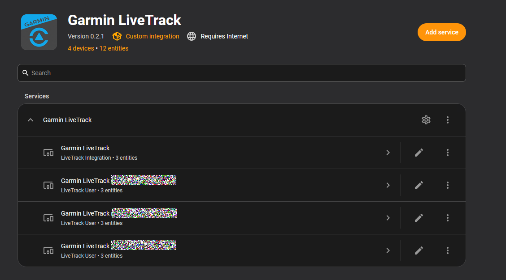
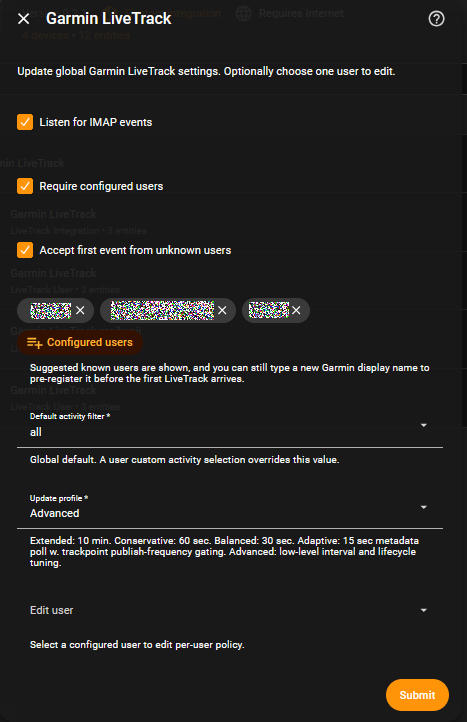
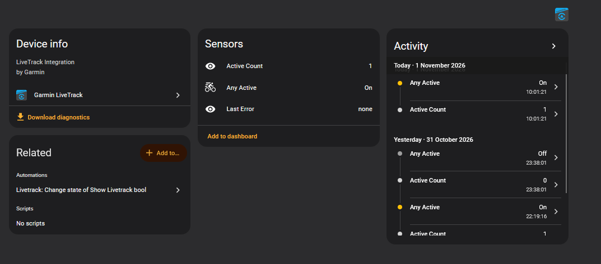
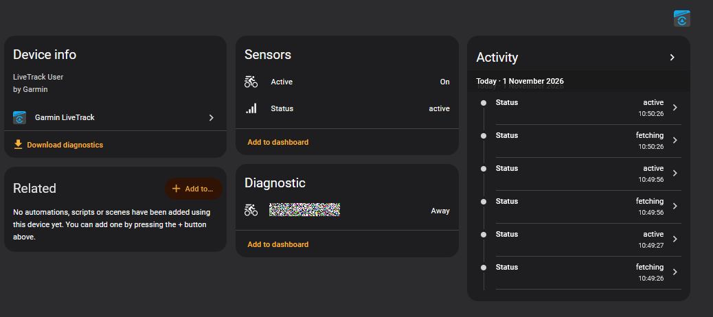

# Garmin LiveTrack

Track Garmin LiveTrack activities in Home Assistant. See who is active, display their location on a map, and use activity updates in your dashboards and automations.

**Repository version: `0.2.3`**, with optional elevation-gain attributes and Garmin LiveTrack API v2 support. See the [release notes](docs/releases/v0.2.3.md) and [published releases](https://github.com/tjuuljensen/ha-garmin-livetrack/releases).

*Example installation. User names are obscured; device counts and settings will depend on your setup.*

## Contents

- [Features](#features)
- [Installation](#installation)
- [Quick start](#quick-start)
- [Everyday settings](#everyday-settings)
- [Devices and dashboards](#devices-and-dashboards)
- [Notifications](#notifications)
- [Privacy and security](#privacy-and-security)
- [Help and further reading](#help-and-further-reading)

## Features

- Add a LiveTrack URL manually or receive it automatically from Garmin emails.
- Track multiple sessions independently.
- Get a device for each Garmin user, with activity status and a location tracker.
- Choose which users and activities to track.
- Restore recoverable sessions after a Home Assistant restart.
- Keep the last finished activity summary for dashboards during the retention window.

Garmin LiveTrack is not a documented public API. Garmin-side changes can affect tracking and may require an integration update.

## Installation

### Home Assistant Marketplace

Marketplace is built into Home Assistant 2026.11 and later, replacing HACS. Existing HACS installations and custom repositories migrate automatically. See the [Marketplace documentation](https://www.home-assistant.io/integrations/marketplace/).

1. Open `Settings -> Marketplace` and select `Add from link`.
2. Enter `https://github.com/tjuuljensen/ha-garmin-livetrack` and select `Add`. Connect GitHub if prompted; choose type `Integration` if requested.
3. Open `Garmin LiveTrack` and select `Install`.
4. Follow the setup prompt, or open `Settings -> Devices & services -> Add integration` and search for `Garmin LiveTrack`. Restart Home Assistant if prompted.

For versioned installs, select a published release. If no release is available, use the manual installation below. Branch contents may include unreleased changes.

Updates appear under `Settings -> Updates`. Restart Home Assistant after updating the integration. On Home Assistant versions before 2026.11, use an existing HACS installation or install manually.

### Manual installation

1. Copy `custom_components/garmin_livetrack` into `/config/custom_components/`.
2. Restart Home Assistant.
3. Add `Garmin LiveTrack` from `Settings -> Devices & Services`.

## Quick Start

1. Start a Garmin LiveTrack activity and confirm that its sharing URL opens in a browser.
2. In Home Assistant, open the integration's gear icon and review the settings. The default `Conservative` update profile is a starting point for general use.
3. Open `Developer tools -> Actions`, select `garmin_livetrack.add_url`, and paste the sharing URL into `url`.
4. Check that `Any Active` turns on, a Garmin user device appears, and its status reaches `active` once Garmin supplies trackpoints.
5. Open the user's device tracker to check its location.

To add sessions automatically, configure Garmin to send LiveTrack emails and follow the [email ingestion setup](docs/ADVANCED.md#email-ingestion).

## Everyday Settings

Open the gear icon on the Garmin LiveTrack integration entry to change settings.

| Setting | What it does |
| --- | --- |
| Listen for IMAP events | Accept LiveTrack URLs from the Home Assistant IMAP integration. |
| Configured users | Pre-register Garmin display names before their first session arrives. |
| Require configured users | Restrict tracking to enabled users. Enable this when you want user approval. |
| Accept first event from unknown users | With approval required, allow a new user's first session before requiring explicit enablement for later sessions. |
| Default activity filter | Track all activities or select an activity type. |
| Update profile | Choose the update frequency. `Conservative` is the default; `Balanced` and `Adaptive` provide more frequent updates. |

Select a user under `Edit user` to change their policy or activity filter. A user's custom activity filter overrides the global default.

Disabled-user policies only block new sessions when `Require configured users` is enabled. Disabling a user does not stop an existing session. See [user approval and removal](docs/ADVANCED.md#unknown-users-and-approval) for the full behavior.

For polling intervals and low-level options, see [update profiles](docs/ADVANCED.md#update-profiles) and [advanced settings](docs/ADVANCED.md#advanced-settings).

## Devices and Dashboards

The integration device shows `Active Count`, `Any Active`, and `Last Error` across your sessions.

Each Garmin user gets a device containing a status sensor, an active indicator, and a location tracker. Use these entities in your dashboards, maps, and automations.

The user device and its tracker use the Garmin display name by default. Map markers show initials unless you supply a picture. Existing entity IDs stay unchanged. See [map names, pictures, and icons](docs/ADVANCED.md#map-names-pictures-and-icons) for YAML customization examples.

Finished-session summaries remain available during the configured retention window, including across Home Assistant restarts. See the [entity reference](docs/ADVANCED.md#entity-reference) for entity IDs and attributes.

When Garmin supplies elevation gain, the status sensor and device tracker expose it as `elevation_gain_m`, separately from current altitude. Sessions without that data show an unknown value; gain is not estimated from altitude changes.

## Notifications

Use Home Assistant automations to send notifications when tracking starts, updates, or ends. The integration supplies entities and events; notification delivery is handled by your automations.

An [example notification package](docs/garmin_livetrack_notifications_example_unverified.yaml) is available for adaptation. It has not been validated on a live Home Assistant/mobile setup. For custom automations, see the [event reference](docs/ADVANCED.md#events).

## Privacy and Security

A full LiveTrack URL contains an access token. The user status sensor exposes that URL in its attributes, and recovery storage and retained summaries also contain sensitive session data. Avoid sharing screenshots or state exports containing those URLs.

Location trackers and activity events expose coordinates. Session diagnostics omit tokens and coordinates but retain Garmin display names and policy settings. Review diagnostics before sharing them. See the [detailed privacy notes](docs/ADVANCED.md#privacy-and-security).

## Help and Further Reading

- If the integration does not load after installation or an update, restart Home Assistant and check that all integration files were copied.
- If a session waits for trackpoints, confirm the sharing URL works in a browser and allow time for Garmin to publish a point.
- If email ingestion does not work, check `Listen for IMAP events` and the [IMAP setup](docs/ADVANCED.md#email-ingestion).

For other problems, see [troubleshooting](docs/ADVANCED.md#troubleshooting) or [report an issue](https://github.com/tjuuljensen/ha-garmin-livetrack/issues).

- [Advanced configuration and reference](docs/ADVANCED.md): email setup, user policies, actions, events, tuning, diagnostics, and local testing.
- [Architecture](docs/ARCHITECTURE.md) and [Garmin fetch strategy](docs/GARMIN_FETCH_STRATEGY.md): implementation details for contributors.
- [Development backlog](TODO.md) and [release notes](docs/releases/v0.2.3.md).
