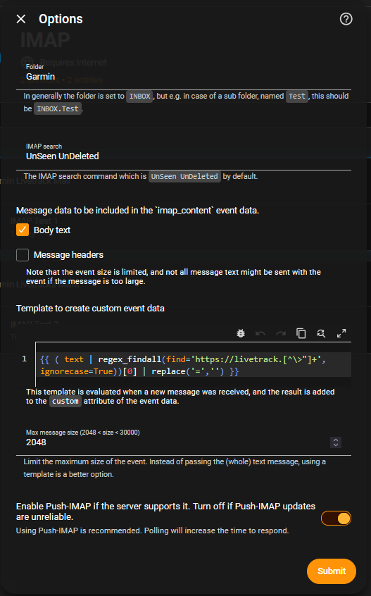
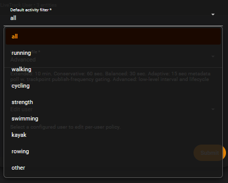
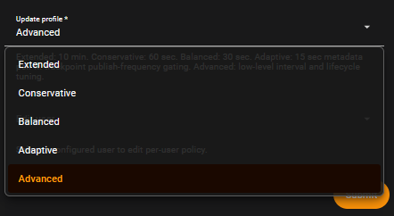

# Advanced Configuration and Reference

Start with the [README](../README.md) for installation and everyday use. This guide covers optional configuration, automation interfaces, troubleshooting, and development. Examples and action names match repository version `0.2.3`.

## Contents

- [Email ingestion](#email-ingestion)
- [Configuration reference](#configuration-reference)
- [Custom HTTP User-Agent](#custom-http-user-agent)
- [Services](#services)
- [Events](#events)
- [Entity reference](#entity-reference)
- [Polling and recovery](#polling-and-recovery)
- [Session lifecycle](#session-lifecycle)
- [Privacy and security](#privacy-and-security)
- [Troubleshooting](#troubleshooting)
- [Local testing](#local-testing)

## Email Ingestion

Configure your Garmin device/app to send LiveTrack emails to a mailbox monitored by Home Assistant. Confirm that the emailed URL opens in a browser.

### IMAP
If you want automatic ingestion from email, configure the [Home Assistant IMAP integration](https://www.home-assistant.io/integrations/imap/) to fire an `imap_content` event. A practical extraction template is:

```jinja

{{ body | regex_findall(find='https://livetrack\.garmin\.com/session/[^"<>\s\x27]+', ignorecase=True) | first | default('') }}
```

The integration listens only for `imap_content` and only extracts Garmin LiveTrack URLs. It does not persist email body content.



*IMAP options for email ingestion. Select the folder that receives your Garmin emails, enable `Body text`, and paste the extraction template above into `Template to create custom event data`. The screenshot uses a different template; use the copyable version above.*

## Configuration Reference

Open the gear icon on the Garmin LiveTrack integration entry.

### Default activity filter

Choose `all` or an activity in `Default activity filter` to set the global activity policy. A user's custom activity selection overrides this default.



### Advanced settings
Advanced settings are shown only through the `Advanced` profile path. They include:
- `HTTP User-Agent`
- `Expose debug attributes`
- `Metadata interval (seconds)`
- `Use Garmin trackpoint publish frequency`
- `Initial trackpoint wait (minutes)`
- `Maximum runtime (hours)`
- `Stale timeout (minutes)`
- `Finalization window (minutes)`
- `Retain ended sessions (hours)`
- `Startup poll defer (seconds)`

`Expose debug attributes` adds HTTP status, trackpoint source, polling-task state, adaptive scheduling, and backoff details to the user status sensor. `last_fetch` and `last_success` are always exposed.

### Per-user policy options
Each known user can have overrides for:
- tracking enabled/disabled (enforced when `Require configured users` is enabled)
- handling mode: `normal`, `register_only`, `one_event_only`
- activity filter mode: `inherit_global` or `custom`
- allowed activities when using custom mode

### Update profiles



*Choose a polling preset, or select `Advanced` to choose a baseline and adjust individual settings.*

- `Extended`
  - default metadata polling interval is 10 minutes
  - lowest Garmin pressure
- `Conservative`
  - default metadata polling interval is 60 seconds
  - default profile for general use
- `Balanced`
  - default metadata polling interval is 30 seconds
  - intended for more responsive dashboards
- `Adaptive`
  - default metadata polling interval is 15 seconds
  - still fetches session metadata normally
  - uses Garmin `postTrackPointFrequency` when available so trackpoint fetches are not attempted before Garmin is likely to have published a new point
  - falls back to the effective metadata interval when Garmin does not provide a usable frequency
- `Advanced`
  - opens an advanced preset step first
  - offers `Extended`, `Conservative`, `Balanced`, or `Adaptive` as the baseline, plus `Existing settings` when advanced settings have already been saved
  - then opens the advanced settings step for low-level overrides

### User matching
User policy matching is case-insensitive internally, while the original Garmin display name is preserved for display and diagnostics.

Garmin identity is based on Garmin `userDisplayName`. It is a user-facing string and not a guaranteed immutable account identifier.

### Unknown users and approval

| Require configured users | Accept first event from unknown users | Behavior for a new Garmin user |
| --- | --- | --- |
| Off | Either | Register the user and track the session. |
| On | Off | Register the user as disabled and reject the session. Enable the user before accepting later sessions. |
| On | On | Accept the first session, then leave the user disabled for subsequent sessions until explicitly enabled. |

Activity filters still apply. With `Require configured users` enabled, sessions without a Garmin display name are rejected. Adding a new name to `Configured users` pre-registers it as enabled; an existing disabled user must be enabled through `Edit user`.

When `Require configured users` is off, a stored disabled-user policy does not block tracking. Disabling a user does not stop an existing session; use `stop_session` or remove the user for that. The handling-mode labels describe registration policy; they are not independent session-count limits.

To remove a user, select them under `Edit user` and choose the remove action. This stops their active sessions and removes their stored policy, retained summaries, and registered entities.

### Activity normalization
The integration preserves both Garmin's raw activity label and a normalized canonical value.

Examples:
- `Trail Running` -> `running`
- `kayaking` -> `kayak`
- `Open Water Swimming` -> `swimming`

Rules:
- the raw Garmin value is kept as `activity_type_raw`
- the normalized value is exposed as `activity_type`
- unknown Garmin activity names are preserved; activity filters can still exclude them
- icon selection is driven by the normalized value

This keeps entity state, events, and diagnostics stable without hiding Garmin-specific values.

## Custom HTTP User-Agent
The integration lets you override the HTTP User-Agent used for Garmin page and API requests.

Default:
- `HomeAssistant-GarminLiveTrack/0.2.3`

Typical reasons to change it:
- Garmin behaves differently for different clients
- you want to compare integration behavior against a browser session
- you want a stable custom identifier during troubleshooting

Recommended approach:
1. Start with the default.
2. Change it only when testing a concrete Garmin behavior difference.
3. Record the chosen value in diagnostics or issue notes when troubleshooting.
4. Clear the field and save if you want to revert to the built-in default.

For browser comparisons, use the User-Agent from the browser you are testing.

Validation:
- empty value resets to the built-in default
- maximum 256 characters
- effective value is shown in diagnostics

## Services
### `garmin_livetrack.add_url`
Add a Garmin LiveTrack URL manually.

Fields:
- `url` required

### `garmin_livetrack.stop_session`
Stop one active session. Supply either `session_id` or `session_id_hash`; omitting both does nothing.

Fields:
- `session_id` optional
- `session_id_hash` optional

### `garmin_livetrack.refresh_session`
Request an immediate refresh for one active session. Supply either `session_id` or `session_id_hash`; omitting both does nothing. Transport backoff still applies.

Fields:
- `session_id` optional
- `session_id_hash` optional

### `garmin_livetrack.refresh_all`
Request an immediate refresh for all active sessions. Transport backoff still applies.

### `garmin_livetrack.clear_ended`
Clear retained ended sessions.

### `garmin_livetrack.reload_users`
Reload stored user policies.

### `garmin_livetrack.set_user_policy`
Update user tracking policy and activity overrides.

Fields:
- `user` required
- `enabled` optional
- `mode` optional: `normal`, `register_only`, or `one_event_only`
- `allowed_activities` optional: comma-separated activity names; `inherit` restores the global filter

### `garmin_livetrack.remove_user`
Remove a user, stop their active sessions, and purge their retained summaries and registered entities. The `user` field is required.

### `garmin_livetrack.list_users`
Return known users plus stored and effective policy information. Also emits `garmin_livetrack_users_listed` with `count` and `users`.

## Events
The integration emits Home Assistant events for automation and package consumers:

- `garmin_livetrack_session_added`
- `garmin_livetrack_session_updated`
- `garmin_livetrack_session_ended`
- `garmin_livetrack_session_rejected`
- `garmin_livetrack_point_received`

Typical event payload fields include:
- `session_id_hash`
- `user`
- `activity_type`
- `activity_type_raw`
- `activity_icon`
- `source`
- `status`
- `reason` on ended and rejected events

Lifecycle and point events share the payload below. Metrics can be `null` when Garmin has not supplied a point. `garmin_livetrack_point_received` fires when a newer point is received; it is not a complete stream of every point returned in a batch.

Point metrics include:
- `latitude`
- `longitude`
- `speed_mps`
- `speed_kmh`
- `pace_min_km`
- `distance_km`
- `duration_s`
- `duration_hms`
- `heart_rate_bpm`
- `power_w`
- `cadence`
- `event_types`
- `altitude_m`
- `elevation_gain_m`
- `has_location`

Events contain no LiveTrack URL or token. A manual stop emits `garmin_livetrack_session_updated` with `status: stopped` and `reason: manual`, rather than `garmin_livetrack_session_ended`.

## Entity Reference
### Global entities
These are attached to one integration-level Garmin LiveTrack device:
- `binary_sensor.garmin_livetrack_any_active`
- `sensor.garmin_livetrack_active_count`
- `sensor.garmin_livetrack_last_error`

`binary_sensor.garmin_livetrack_any_active` also exposes aggregate attributes:
- `active_count`
- `active_users`
- `active_activities`
- `active_summaries`

The icon follows the activity when all active sessions share the same normalized activity, including multiple sessions for one user. Mixed activities use `mdi:map-marker-multiple`; no active sessions use `mdi:map-marker-path`. Counts and summaries remain per session, so a user can appear more than once. Sessions fetching data, waiting for a first trackpoint, or ending also count as active.

### Per-user entities
Each known Garmin user gets a stable Home Assistant device with:
- status sensor
- active binary sensor
- device tracker

The per-user status sensor retains the most recent ended session during the configured retention window so dashboards can continue to show the final activity state and summary values after the LiveTrack stops. Retained ended-session summaries are stored and restored across Home Assistant restarts.

The status sensor, device tracker, and session/point events expose `elevation_gain_m` in metres, separately from current altitude. It reads Garmin's `totalElevationGainMeters`, falling back to `elevationGainMeters`. Missing gain stays `null` until Garmin supplies it; sparse later points retain the last supplied value. The integration does not estimate gain from altitude changes.

### Session fallback device
If a session becomes active before Garmin returns a user display name, the integration can use a temporary session-based fallback device until a user identity is known.

### Map names, pictures, and icons

User devices are named after the Garmin display name, and the location tracker uses that device name without a `Garmin LiveTrack` prefix. Before the first session, configured users keep the spelling of their configured name. Unidentified sessions use `Session <short hash>` as a fallback. The integration-level device is still named `Garmin LiveTrack`.

This display change preserves existing entity IDs and device identifiers, so dashboard and automation references keep working. User-supplied device names, entity names, and YAML customizations remain in effect. If an old label still appears after restarting Home Assistant, check the tracker and device name overrides under `Settings -> Devices & services`, along with any map-card name override. Clear an override to use the new default; do not recreate entity IDs.

Home Assistant normally shows the tracker's picture on a map, or initials when there is no picture. The activity icon used elsewhere changes with the activity and its status. You can customize these through Home Assistant without mapping the tracker to a Person.

#### Custom name and photo

Add this to `configuration.yaml`, replacing `device_tracker.your_garmin_tracker` with the tracker's existing entity ID:

```yaml
homeassistant:
  customize:
    device_tracker.your_garmin_tracker:
      friendly_name: "Thomas"
      entity_picture: /local/thomas.jpg
```

Place `thomas.jpg` in `/config/www/` (create `www` if necessary); Home Assistant serves it as `/local/thomas.jpg`. Both customization fields are optional: omit `friendly_name` to keep the default name, or omit `entity_picture` to keep initials.

Merge this into an existing `homeassistant:` / `customize:` section rather than creating duplicate keys. If you already use `customize: !include customize.yaml`, put only the entity ID and its attributes in that file. Reload `Location & customizations` under `Developer tools -> YAML`, or restart Home Assistant. Restart if you have just created the `www` folder.

#### Custom icon on a map card

For a fixed icon, use this alternative customization (or add its `icon` field to your existing entry):

```yaml
homeassistant:
  customize:
    device_tracker.your_garmin_tracker:
      icon: mdi:run
```

A fixed icon overrides the integration's automatic activity icon changes. Setting `icon` alone does not replace initials on the default map marker. On Home Assistant versions supporting `label_mode`, add this custom dashboard map card to explicitly show the icon:

```yaml
type: map
entities:
  - entity: device_tracker.your_garmin_tracker
    label_mode: icon
```

Omit the fixed `icon` customization to show the integration's changing activity icon in this card. For a photo marker, use the first example and omit `label_mode` from the map card.

See Home Assistant's [entity customization](https://www.home-assistant.io/docs/configuration/customizing-entities), [local file hosting](https://www.home-assistant.io/integrations/http/#hosting-files), and [map card](https://www.home-assistant.io/dashboards/map/) documentation.

## Polling and Recovery

Each session polls independently. The integration fetches Garmin session metadata and trackpoints, with payload and page-data fallbacks when needed. The `Adaptive` profile uses Garmin publishing frequency to avoid premature trackpoint requests.

Temporary failures apply per-session backoff:

- `429`: 2 minutes initially, increasing up to 15 minutes
- `5xx` and retryable request failures: 30 seconds initially, increasing up to 10 minutes
- `403` after the CSRF retry fails: 1 minute initially, increasing up to 5 minutes

Successful requests clear backoff. Lifecycle handling continues during cooldowns.

Recoverable sessions and retained ended-session summaries are restored from Home Assistant storage after a restart. Restored pollers wait for `Startup poll defer` before fetching.

See [Architecture](ARCHITECTURE.md) and [Garmin fetch strategy](GARMIN_FETCH_STRATEGY.md) for implementation details.

## Session Lifecycle
### Typical states
- `discovered`
- `fetching`
- `waiting_for_trackpoint`
- `active`
- `ending`
- `ended`

Other terminal/problem states include:
- `expired`
- `stale`
- `stopped`
- `garmin_error`
- `rejected_user`
- `rejected_activity`

### Finalization and stale handling

An explicit Garmin `END` point finalizes the session immediately. A Garmin end timestamp or a period without new points can also end a session.

For sessions with points but no `END`, the no-progress timeout leads to `ending` and then `ended`, with reason `inactive_no_end`. The finalization window is measured from the start of the no-progress period, so `ending` may be brief when that window has already elapsed.

Sessions that never produce points become `stale` after the initial trackpoint wait plus the stale timeout, unless an end timestamp already identifies them as finished. Prolonged fetch failures can also produce `stale`; the maximum runtime produces `expired`, and a manual stop produces `stopped`.

The status sensor attribute `end_reason` explains why a session finished.

## Privacy and Security

A full Garmin LiveTrack URL contains an access token. The user status sensor intentionally exposes that URL in its `url` attribute for dashboards and troubleshooting. Home Assistant storage also keeps tokens for restart recovery and full URLs in retained ended-session summaries.

The integration omits tokens from its event payloads and session diagnostics, and uses redacted URLs in diagnostics. Diagnostics still contain Garmin display names, configured users, and policy settings; review them before sharing.

Coordinates are exposed through device trackers and lifecycle/point events. Session diagnostics omit coordinates. Treat dashboards, state exports, recordings of entity attributes, and screenshots containing LiveTrack URLs as sensitive.

## Troubleshooting
### `Config flow could not be loaded`
Restart Home Assistant after updating the custom integration. Ensure the full updated custom component is deployed before retrying.

### Session stuck in `waiting_for_trackpoint`
Use `refresh_session` or `refresh_all` and, if needed, enable `Expose debug attributes` to inspect:
- `page_status`
- `api_status`
- `trackpoints_source`
- `poll_task_alive`

### Restart recovery is slow
Check:
- `defer_startup_poll_seconds`
- diagnostics
- debug logs for startup timing breadcrumbs

### IMAP is not creating sessions
Confirm:
- `Listen for IMAP events` is enabled
- the IMAP integration is firing `imap_content`
- the event body contains a Garmin URL
- quoted-printable soft line breaks are removed

### Invalid URL
Only Garmin LiveTrack URLs hosted on `livetrack.garmin.com` are accepted.

### Missing session or missing trackpoints
This can mean:
- Garmin changed response shape
- the session is no longer public or available
- Garmin returned a transient incomplete payload

Check:
- diagnostics
- status sensor debug attributes if enabled
- configured `HTTP User-Agent`
- browser behavior with the same LiveTrack

`missing_trackpoints` during startup is treated as a transient session condition while the integration is still waiting for the first usable point.

The repair signal is reserved for more durable anomalies such as:
- repeated `missing_session` responses
- repeated `missing_trackpoints` after a session had already produced points
- sessions that fully age out and end with `no_trackpoints`

If those patterns repeat, Home Assistant should also raise a Garmin LiveTrack repair issue indicating that the Garmin response shape may have changed.

## Local Testing
Run the full repo pytest suite from the repository root in a Python 3.12 environment aligned with CI:

```powershell
powershell -ExecutionPolicy Bypass -File .\scripts\test-local.ps1
```

Linux/macOS:

```bash
bash ./scripts/test-local.sh
```

Useful options:

```powershell
powershell -ExecutionPolicy Bypass -File .\scripts\test-local.ps1 -RecreateVenv
powershell -ExecutionPolicy Bypass -File .\scripts\test-local.ps1 -SkipInstall
powershell -ExecutionPolicy Bypass -File .\scripts\test-local.ps1 -PythonCommand "python3.12"
```

```bash
bash ./scripts/test-local.sh --recreate-venv
bash ./scripts/test-local.sh --skip-install
bash ./scripts/test-local.sh --python python3.12
```

## Further Reading

- [Architecture and release checklist](ARCHITECTURE.md)
- [Garmin request and parsing pipeline](GARMIN_FETCH_STRATEGY.md)
- [Development backlog](../TODO.md)
